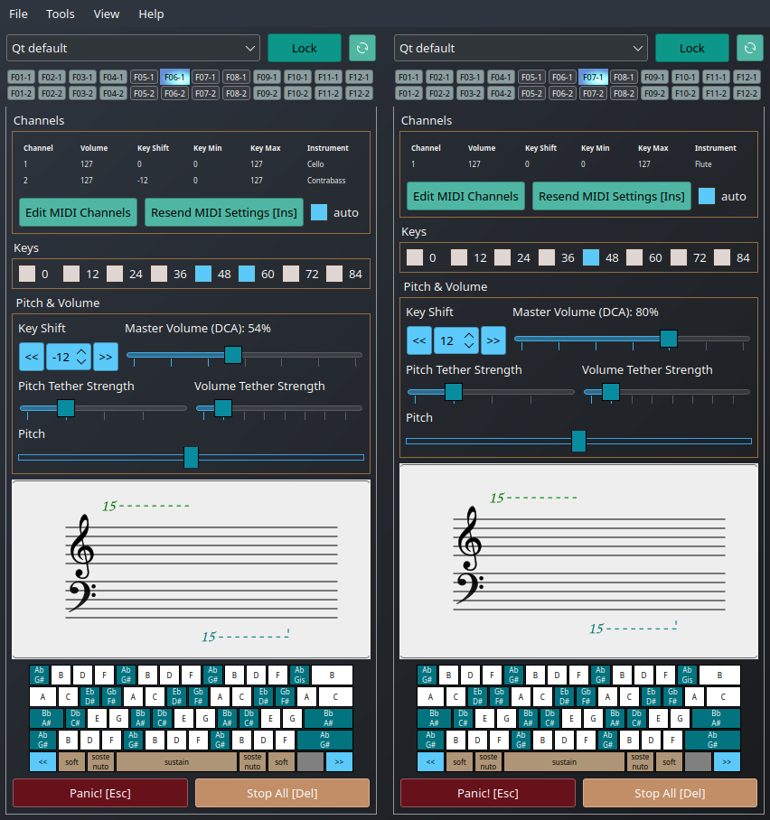
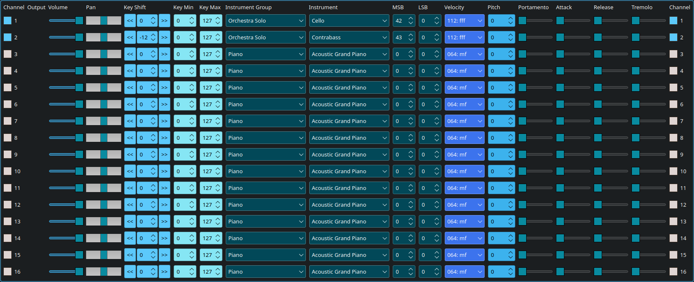

# vkeybd-qt
MIDI-Software controller for the PC-Keyboard with a lot of functions






## Patch ZIPs and source snapshots

From any working directory, run:

```bash
./tools/zip_vkeybd_project.sh [output.zip]
./tools/apply_patch.sh /path/to/vkeybd-<description>.zip
```

The ZIP snapshot defaults to `../vkeybd.zip` (beside the project checkout).
It contains Git-tracked and non-ignored untracked source files, excluding
generated builds, known secrets, and compiled helper executables. Its paths
always begin with `vkeybd-qt/`, regardless of the checkout folder name.

Patch ZIPs must be named `vkeybd-<description>.zip` and contain only
changed or added files below `vkeybd-qt/`. To delete files, optionally include
a UTF-8 `vkeybd-qt/.vkeybd-patch-delete.txt` listing relative file paths, one
per line. The patch applicator validates paths, refuses symlinks and unsafe
entries, writes changed files using atomic replacements, refreshes their
modification times, and regenerates `../vkeybd.zip` on success. Requires
Python 3 and Git.

Run `./tests/test_patch_tooling.sh` to test this machinery in temporary Git
checkouts.

## Build (Linux, CMake + Ninja)

Install CMake (3.21+), Ninja, a C++17 compiler, pkg-config, Qt 6 (Core,
Gui, Widgets, Svg, SvgWidgets, Network, DBus, Test), ALSA development files,
and JACK development files. For Debian/Ubuntu, an example is:

```bash
sudo apt install cmake ninja-build g++ pkg-config qt6-base-dev qt6-svg-dev \
    libasound2-dev libjack-jackd2-dev
```

Build the application without launching it:

```bash
./compile_linux.sh debug       # build-debug/vkeybd-qt (default)
./compile_linux.sh release     # build-release/vkeybd-qt
```

Build **and run** the application (legacy entry point):

```bash
./compile.sh debug            # or: ./compile.sh release
```

Build and run the GUI-independent QtTest suite:

```bash
./compile_linux_tests.sh debug
./compile_linux_tests.sh release
```

Tests are registered with CTest, so you may also run
`ctest --test-dir build-debug --output-on-failure`.
If you want to test an existing INI file, use
`VKEYBD_INI=/path/to/save.ini ./compile_linux_tests.sh debug`.

The new source layout is `src/` (application C++ code, headers and Qt
resources), `tests/` (unit tests), and `assets/` (runtime resources).
CMake files are `CMakeLists.txt` at the project root, in `src/` and in
`tests/`. The obsolete `.pro` projects are no longer needed. All generated
files, including Qt moc/rcc outputs, test executables and Make/Ninja metadata,
stay under `build-debug/` or `build-release/`, which are ignored by Git and
excluded from source snapshot ZIPs.
